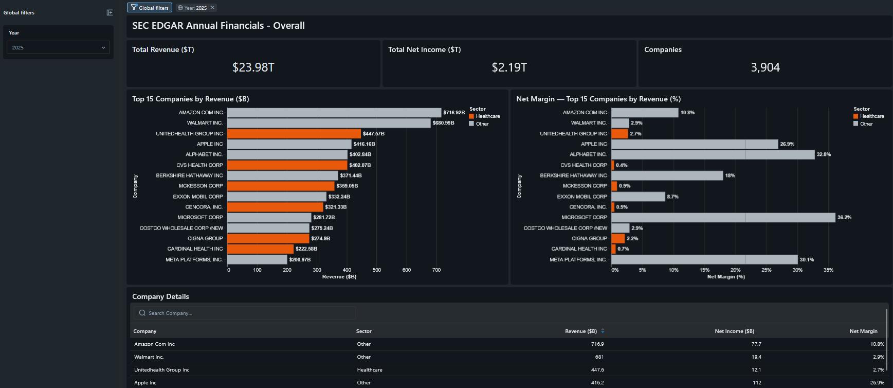
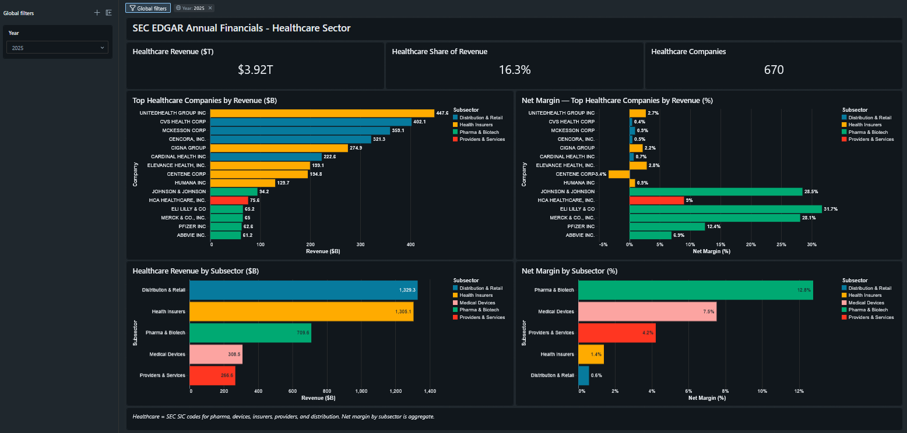

# SEC EDGAR Financial Pipeline on Databricks

An automated pipeline that loads the SEC's quarterly Financial Statement Data Sets into bronze/silver/gold Delta tables on Databricks, with a two-page dashboard: all public companies, and the healthcare sector.

<p align="center">
  
  <br>
  <em>Overall dashboard generated in Databricks.</em>
  <br><br>
  
  <br>
  <em>Analysis dashboard focused on the healthcare sector.</em>
  <br>
</p>

## Overview

The source is the SEC's [Financial Statement Data Sets](https://www.sec.gov/data/financial-statement-data-sets): one zip per quarter containing the numbers from companies' 10-K and 10-Q filings. Each zip covers filings *submitted* in that quarter, so every release stands alone. The pipeline automates loading whatever new quarter appears and rebuilds the analytics tables. I built this project mainly to learn Databricks and understand its features.

- **Loaded:** 15 quarters, 2023 Q1 to 2026 Q3: about 102,000 submissions (all form types) and 54.0M raw fact rows in bronze
- **Stack:** Databricks (Unity Catalog, Delta Lake, Jobs, AI/BI dashboards), PySpark, SQL

## Architecture

```
landing/zips/YYYYqN.zip
        |
        v
Job: edgar_pipeline
  bronze_load -> silver_build -> gold_build -> checks
        |
        v
Dashboard: Overall | Healthcare
```

The Job starts automatically through a file-arrival trigger on `landing/zips/`: dropping in a new quarterly zip kicks off a run, with no manual step. Email notifications are configured on the Job.

| Layer | Table | One row is |
|---|---|---|
| Bronze | `bronze_sub`, `bronze_num` | A raw line from the SEC file (all columns strings) plus source quarter, file name, load time |
| Bronze | `ingestion_log` | One quarter loaded, with row counts |
| Silver | `silver_filings` | One 10-K or 10-Q (amendments flagged), with typed dates and a sector label |
| Silver | `silver_facts` | One number from a filing: revenue, net income, assets, liabilities, or equity |
| Silver | `ref_sic_sector` | Lookup from SEC industry code (SIC) to sector and subsector |
| Gold | `gold_company_period` | One company's results for one period, metrics side by side |
| Gold | `gold_sector_summary` | Totals by sector, subsector, and period |

## Design decisions

- **Reloads by quarter.** Each quarter is written with Delta `replaceWhere`, so loading or reloading a quarter replaces only that quarter's rows. This works because every filing's accession number appears in exactly one quarterly file, and amendments arrive as new filings. It is simpler than a row-level `MERGE`.
- **`ingestion_log` decides what is new**, not file paths, so moving or renaming files never causes a reload. A load is logged only after both tables load and the row counts match the source file.
- **Silver keeps only what the dashboard needs:** 10-K and 10-Q filings, consolidated USD values, standard US-GAAP tags, and five metrics. Dimensional breakdowns (segments, co-registrants) are dropped so numbers are not double-counted.
- **Gold uses the filing's own period.** A 10-K also contains prior-year comparison numbers, so gold keeps only facts dated at the filing's period end, and picks the right period length (`qtrs`: 4 for annual, 1 for quarterly, 0 for balance sheet items). The latest filing wins when a company has more than one for a period.
- **Revenue comes from a ranked tag list** (`Revenues`, then the two ASC 606 contract-revenue tags, then `RevenuesNetOfInterestExpense`), chosen from which tags filers actually use in the data.
- **Healthcare is a filter, not a second pipeline.** A `sector` column from SIC codes lets both dashboard pages read the same tables.
- **Left out on purpose:** streaming, CI/CD, ML, and loading every quarter since 2009. The scope is one pipeline that is easy to read and maintain.

## Validation

- `checks` runs at the end of every Job and fails the run if any of these is non-zero: duplicate filings, duplicate facts, quarters in bronze but missing from silver, duplicate company-periods. All pass.
- Each bronze load compares rows written to the source file's line count and stops on a mismatch.
- Company-level and sector-level revenue totals agree within 0.3% (2023: $22.114T vs $22.048T; 2024: $23.020T vs $22.959T). The small gap is expected, because the sector table also requires reported net income.
- A scan for extreme margins found mostly real one-time events (large impairments and gains) plus the financial-company issue described below.

## Demo: new data arrives

I loaded a 12-quarter baseline (2023 Q1 to 2025 Q4) and held back later quarters to test the automation.

- Annual reports for fiscal 2025 numbered **795** with the baseline alone. They were all non-December year-ends, because most December 10-Ks are filed in the following January to March.
- After `2026q1`, `2026q2`, and `2026q3` loaded, the count rose to **3,919**, and `ingestion_log` grew from 12 to 15 rows. Existing quarters kept their original load timestamps.
- A run with nothing new reloads no quarters: the `bronze_*` tables, `silver_filings`, and `silver_facts` are untouched, and only the small `ref_sic_sector` lookup and the gold tables are rebuilt, with unchanged results.

## Dashboard

**Overall:** total revenue, total net income, and company count; the top 15 companies by revenue next to their net margins (size is not profitability: Amazon and Walmart lead on revenue, Walmart at about a 3% margin, while Apple sits near 27%); and a searchable table of all companies.

**Healthcare:** the same year filter, healthcare revenue and share of total (15.6% in 2023, 16.2% in 2024, 16.3% in 2025), the top 15 healthcare companies by revenue and margin, and revenue and margin by subsector.

The live dashboard runs in a private Databricks workspace; screenshots are shown above.

## Known limitations

- **Banks, insurers, and REITs are unreliable.** They structure revenue differently, so the revenue tag often captures only a component. Some computed margins exceed 100% (for example, Huntington Bancshares), which reflects the revenue-tag problem, not the company's actual results. Health insurers such as UnitedHealth report revenue normally.
- **Revenue uses standard US-GAAP tags only.** Companies reporting under IFRS or using custom revenue tags are excluded.
- **Healthcare is defined by SEC SIC codes** (see `ref_sic_sector`). The classification has quirks, for example CVS Health is classified as Distribution & Retail because of its pharmacy code.
- **Annual years are complete only after December year-end filings load.** 2025 is nearly complete (3,919 annual reports vs 4,103 for 2024); 2026 is partial and excluded from the dashboard.
- **Net income** is net income attributable to the parent where reported (`NetIncomeLoss`), otherwise `ProfitLoss`, and includes one-time items. Subsector margins are aggregates, so large companies dominate them.
- **`period_year`** is the calendar year of the period end date, not the company's own fiscal-year label (for example, Walmart's fiscal year ending January 2025 appears as 2025).
- **Dashboard year ranges are set by hand** (currently 2023-2025) so partial years stay out.
- The `REPROCESS` path that forces a reload of one quarter is built but not yet tested.

## How to run it

1. In Databricks (Free Edition works), create a catalog `edgar` with a schema `pipeline` and a volume `landing` containing a `zips/` folder. These names are set at the top of each notebook (`CATALOG`, `SCHEMA`) and can be changed.
2. Download the quarterly zips from the SEC page above and upload them to `zips/` (names like `2025q4.zip`).
3. Run `01_bronze_load`, `02_silver_build`, `03_gold_build`, then `99_checks`, or create a Job with those four tasks in that order.
4. Build the dashboard from `gold_company_period` and `gold_sector_summary`.

New quarters: upload the zip to `zips/`. The file-arrival trigger starts the Job, or you can run it manually.

## Repository

```
notebooks/
  01_bronze_load.py
  02_silver_build.py
  03_gold_build.py
  99_checks.py
  scratch/
    exploration.py     # tag, IFRS, and sector checks behind the design decisions
dashboard/             # exported dashboard definition
  SEC EDGAR Annual Financials.lvdash.json
images/                # dashboard screenshots
  secedgar_healthcare.png
  secedgar_overall.png
```

## License

This project is licensed under the MIT License. See [LICENSE](LICENSE).
